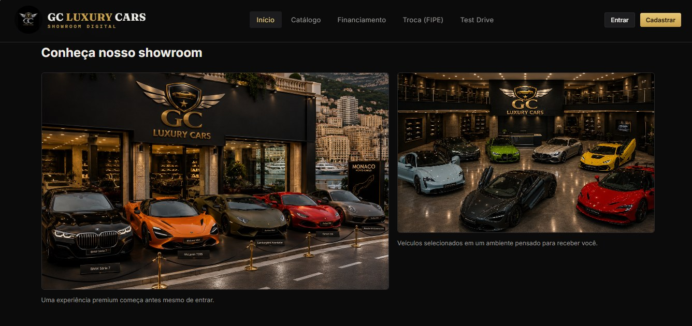
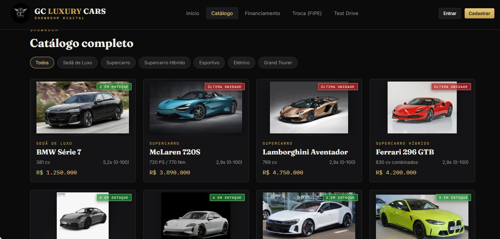
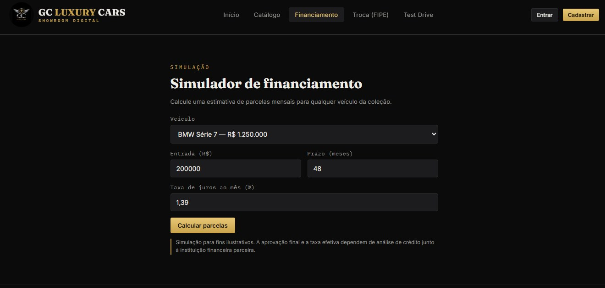
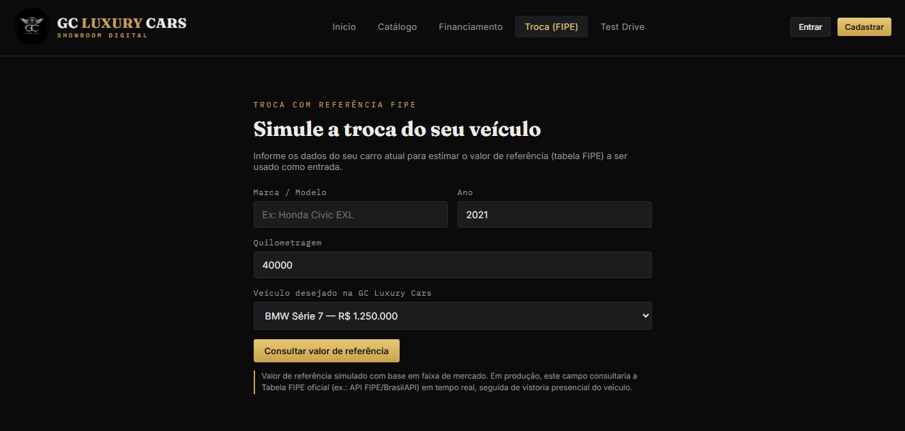
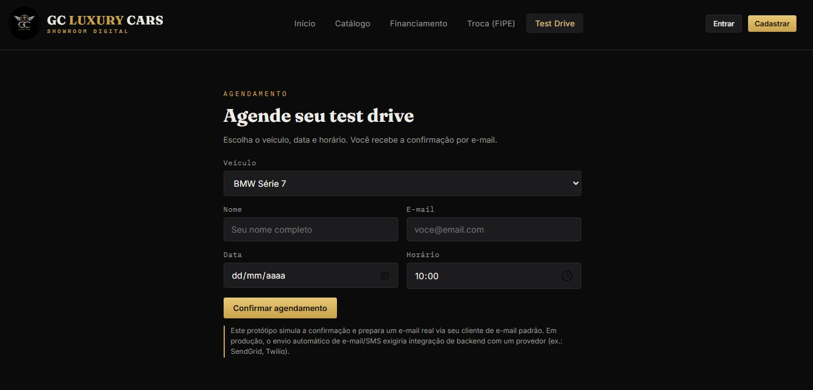
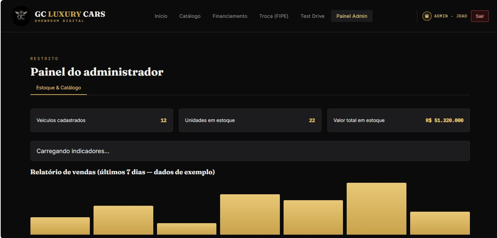
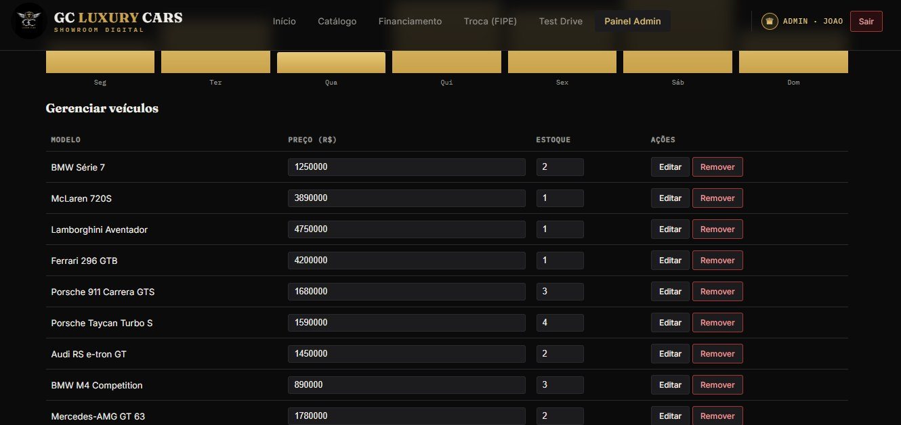
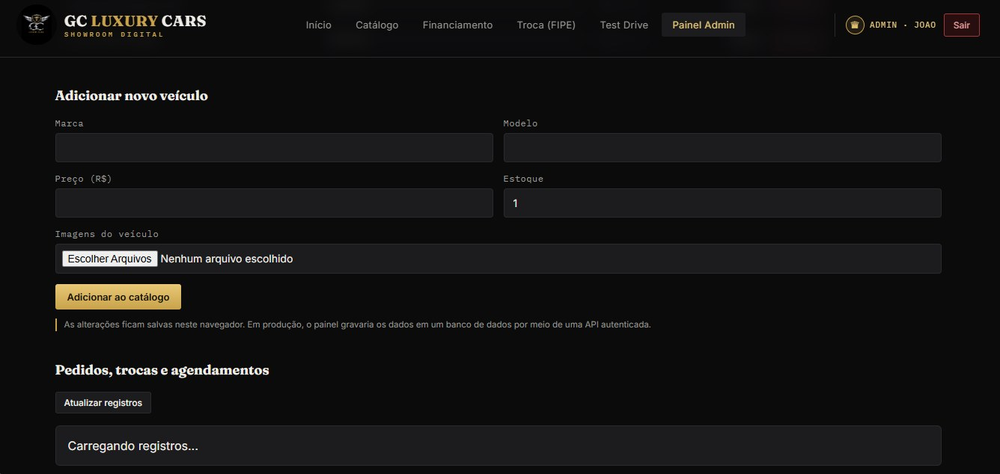
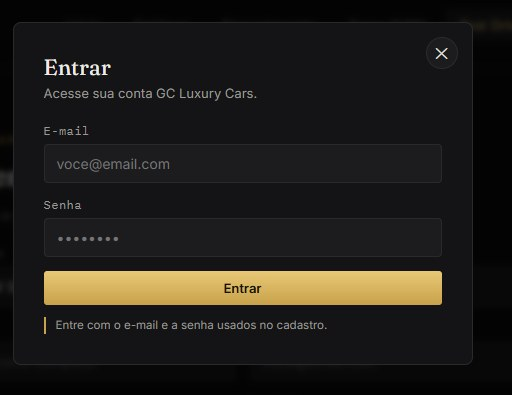
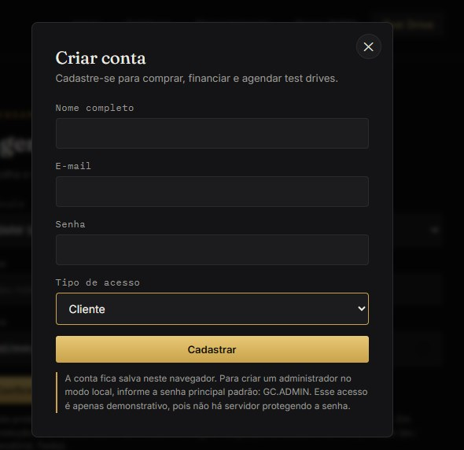

# GC Luxury Cars

### Showroom digital de veículos premium

Uma aplicação web para apresentar veículos de luxo, explorar o catálogo e demonstrar fluxos digitais de financiamento, troca de veículo e agendamento de test drive.

**Projeto de portfólio • Desenvolvimento Web**

---

## Sobre o projeto

O **GC Luxury Cars** é um projeto de showroom digital com identidade visual premium, tema escuro e detalhes dourados. A interface reúne páginas para consulta de veículos e telas que simulam etapas comuns da experiência de compra em uma concessionária.

O projeto foi desenvolvido como prática de desenvolvimento web e organização de interfaces, com foco em navegação clara, apresentação de informações e experiência do usuário.

## Funcionalidades demonstradas

- **Página inicial:** apresentação do showroom e chamadas para ação.
- **Catálogo de veículos:** cards com imagens, categorias, preços, potência, desempenho e indicação de estoque.
- **Detalhes do veículo:** ficha técnica, galeria de imagens e opções de ação.
- **Simulador de financiamento:** seleção do veículo, entrada, prazo e taxa mensal para estimativa de parcelas.
- **Simulação de troca (FIPE):** formulário com marca/modelo, ano, quilometragem e veículo desejado.
- **Agendamento de test drive:** seleção de veículo, data, horário e dados de contato.
- **Autenticação visual:** telas de entrada e criação de conta.
- **Painel administrativo:** indicadores, gestão de veículos, edição de preço/estoque e formulário para adicionar veículos.

> **Nota sobre o estado do projeto:** algumas telas indicam que os dados são demonstrativos e ficam salvos no navegador, e que integrações reais exigiriam uma API/backend. A conexão efetiva com MySQL, a autenticação segura e o envio real de e-mails devem ser descritos como implementados somente se estiverem funcionando no código atual.

## Tecnologias

- **HTML5** — estrutura das páginas.
- **CSS3** — layout, responsividade e identidade visual.
- **JavaScript** — interações e comportamento da interface.
- **Node.js** — ambiente para funcionalidades de servidor, conforme implementado no projeto.
- **MySQL** — banco de dados previsto/utilizado conforme a integração existente no código.

## Galeria

### Página inicial e catálogo

| Página inicial | Catálogo de veículos |
|---|---|
|  |  |

### Detalhes e simuladores

| Detalhes do veículo | Financiamento |
|---|---|
|  |  |

| Troca com referência FIPE | Agendamento de test drive |
|---|---|
|  |  |

### Administração e conta

| Painel administrativo | Gerenciamento de veículos |
|---|---|
|  |  |

| Cadastro de veículo | Login |
|---|---|
|  |  |

## Como executar

Os passos exatos dependem da estrutura do repositório. Para uma aplicação estática, abra o arquivo `index.html` no navegador ou utilize a extensão **Live Server** no Visual Studio Code.

Se o projeto incluir um servidor Node.js e conexão MySQL, confira o `package.json`, os arquivos de configuração e as instruções do próprio código para instalar dependências, configurar as variáveis de ambiente e iniciar o servidor. **Não publique senhas, tokens ou credenciais no GitHub.**

## Próximas melhorias

- Integrar a aplicação a uma API Node.js e ao banco MySQL, caso ainda não esteja conectado.
- Implementar autenticação segura e controle de permissões no servidor.
- Persistir cadastros, estoque, pedidos e agendamentos no banco de dados.
- Integrar uma fonte confiável para consulta de valores FIPE.
- Implementar envio real de confirmações de agendamento por e-mail.
- Adicionar testes, validações e documentação de instalação.

## Objetivo de aprendizagem

Este projeto permite praticar construção de interfaces, organização de páginas, formulários, apresentação de dados e planejamento de funcionalidades para uma aplicação web.

---

Desenvolvido por **João Paulo Godoi Filho**  
GitHub: [@MANOJONASG](https://github.com/MANOJONASG)

